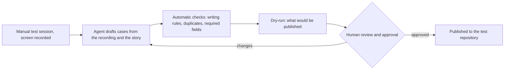

# Case study: from one test plan per sprint to a test repository by journey, with an AI-assisted workflow

> **Fictional scenario, real techniques.** The company, product, team, stories and numbers below are invented. The problems, decisions and techniques are the ones I applied in a real project. No client information appears here.

[Português](../pt-br/repositorio-de-casos-e-fluxo-com-ia.md)

| | |
|---|---|
| **Product** | *TrilhaFit*, gym class booking app (web, Android, iOS) plus a web-only admin portal |
| **Team** | 3 QAs working as peers, each owning the stories of one or more user journeys |
| **My part** | Proposed and carried out the repository reorganization; built the AI-assisted workflow, now shared with the QA team |
| **Labels** | ✅ Applied in practice (reorganization and AI workflow) |

---

## 1. The problem
Test cases lived in **one test plan per sprint**. After nine sprints that meant:
- The same behavior written several times, in different plans, with small differences.
- No single place to answer "what do we have for *Booking*?".
- No base for a **regression suite**: to rerun booking tests, someone had to search nine plans.
- A case written for Android, then copied for iOS and web, drifting apart over time.

## 2. The decision: organize by journey, not by time
| Before | After |
|---|---|
| One plan per sprint | **One central repository** |
| Cases scattered by sprint | **Suites by user journey** (Booking, Waitlist, Profile, Admin: access management...) |
| Sprint as the container | Sprint recorded as a **field** of the case (iteration) |
| Link to the story only by location | **Story ID inside each case** (traceability) |
| One copy per platform | **One case, several platforms**, split only when behavior differs (the admin portal is web only) |

**Why journeys:** they match how the team splits work (each QA owns journeys), how the business talks about the product, and how a regression is chosen ("we changed booking, rerun Booking and Waitlist").

## 3. How the move was done
1. **Inventory:** listed every case with its story, platform and journey.
2. **Structure first:** created the suites by journey and agreed on them with the team before moving anything.
3. **Move with a human gate:** an AI agent proposed where each case should go; I reviewed the proposal before it was applied.
4. **Deduplicate:** cases describing the same behavior were merged, keeping the clearest version.
5. **Review the writing standard:** with the new structure in place, we started revisiting how cases and suites are written.

## 4. The AI-assisted workflow
After the reorganization, the next bottleneck was **writing cases** after each story was tested. The workflow below turns my test session into reviewed case drafts.

**Principles behind it**
- **AI drafts, a person decides.** Nothing reaches the repository without explicit approval.
- **The approval is tied to the exact content.** If the drafts change after approval, the approval no longer counts.
- **Checks before people.** Writing rules and duplicate detection run automatically, so the review is about behavior, not formatting.
- **Dry-run always.** Before publishing, the workflow shows exactly what would be created or changed.
- **The tooling is tested too.** The scripts behind the workflow have their own automated tests.

**Fictional example:** for story BK-111 (waitlist promotion), one recorded session produced 30 drafts. Checks flagged 4 duplicates and 2 cases missing preconditions; after review, 24 cases were published to the *Waitlist* suite.

## 5. Results
- One place to find every case of a journey, ready to become a regression suite.
- Less duplication, and cases that state their platforms and their story.
- Case drafts produced right after testing, under the same review standard.
- A workflow the whole QA team can use for their own journeys.

## 6. What I would do differently
- Agree on the writing standard **before** moving cases, not after: part of the move had to be revisited.
- Define the regression criteria (which cases, by risk) at the same time as the suites.

## Techniques and concepts involved
Test repository organization, traceability (story ↔ case), risk-based selection of regression, review with human approval, and the [test case](../../templates/en/test-case.md) writing rules from this portfolio.
