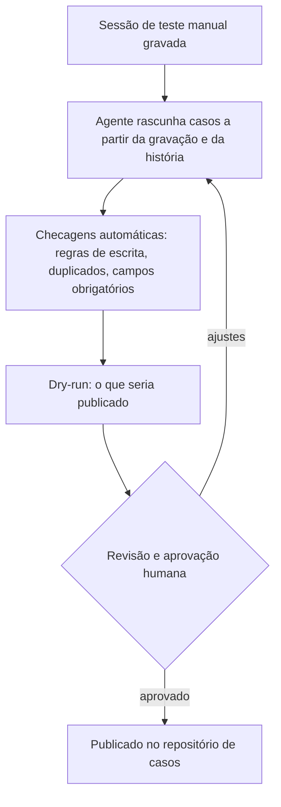

# Estudo de caso: de um plano de teste por sprint para um repositório de casos por jornada, com um fluxo assistido por IA

> **Cenário fictício, técnicas reais.** Empresa, produto, time, histórias e números abaixo são inventados. Os problemas, as decisões e as técnicas são os que apliquei num projeto real. Nenhuma informação de cliente aparece aqui.

[English](../en/test-repository-and-ai-workflow.md)

| | |
|---|---|
| **Produto** | *TrilhaFit*, app de reserva de aulas de academia (web, Android, iOS) mais um portal administrativo só web |
| **Time** | 3 QAs atuando como pares, cada uma dona das histórias de uma ou mais jornadas |
| **Minha parte** | Propus e conduzi a reorganização do repositório; montei o fluxo assistido por IA, hoje compartilhado com o time de QA |
| **Selo** | ✅ Aplicado na prática (reorganização e fluxo com IA) |

---

## 1. O problema
Os casos de teste ficavam em **um plano de teste por sprint**. Depois de nove sprints, isso significava:
- O mesmo comportamento escrito várias vezes, em planos diferentes, com pequenas diferenças.
- Nenhum lugar único para responder "o que temos de *Reserva*?".
- Nenhuma base para uma **suíte de regressão**: para rodar de novo os testes de reserva, alguém tinha que procurar em nove planos.
- Caso escrito para Android, copiado para iOS e web, e cada cópia mudando com o tempo.

## 2. A decisão: organizar por jornada, não por tempo
| Antes | Depois |
|---|---|
| Um plano por sprint | **Um repositório central** |
| Casos espalhados por sprint | **Suítes por jornada** (Reserva, Lista de espera, Perfil, Admin: gestão de acessos...) |
| Sprint como contêiner | Sprint registrada como **campo** do caso (iteração) |
| Ligação com a história só pela localização | **ID da história dentro de cada caso** (rastreabilidade) |
| Uma cópia por plataforma | **Um caso, várias plataformas**, separado só quando o comportamento muda (o portal admin é só web) |

**Por que jornada:** é como o time divide o trabalho (cada QA é dona de jornadas), como o negócio fala do produto e como se escolhe uma regressão ("mexemos na reserva, roda Reserva e Lista de espera").

## 3. Como a mudança foi feita
1. **Inventário:** listei todos os casos com história, plataforma e jornada.
2. **Estrutura primeiro:** criei as suítes por jornada e alinhei com o time antes de mover qualquer coisa.
3. **Mover com aprovação humana:** um agente de IA propôs para onde ia cada caso; eu revisei a proposta antes de aplicar.
4. **Tirar duplicados:** casos que descreviam o mesmo comportamento foram unidos, ficando a versão mais clara.
5. **Rever o padrão de escrita:** com a estrutura nova no lugar, começamos a revisar como casos e suítes são escritos.

## 4. O fluxo assistido por IA
Depois da reorganização, o próximo gargalo era **escrever os casos** depois de testar cada história. O fluxo abaixo transforma a minha sessão de teste em rascunhos de casos revisados.

**Princípios por trás**
- **A IA rascunha, uma pessoa decide.** Nada chega ao repositório sem aprovação explícita.
- **A aprovação fica presa ao conteúdo exato.** Se os rascunhos mudarem depois da aprovação, ela deixa de valer.
- **Checagem antes de gente.** Regras de escrita e detecção de duplicados rodam sozinhas, então a revisão é sobre comportamento, não formatação.
- **Sempre dry-run.** Antes de publicar, o fluxo mostra exatamente o que seria criado ou alterado.
- **A ferramenta também é testada.** Os scripts por trás do fluxo têm testes automatizados próprios.

**Exemplo fictício:** para a história BK-111 (promoção da lista de espera), uma sessão gravada gerou 30 rascunhos. As checagens apontaram 4 duplicados e 2 casos sem pré-condição; depois da revisão, 24 casos foram publicados na suíte *Lista de espera*.

## 5. Resultados
- Um lugar só para achar todos os casos de uma jornada, pronto para virar suíte de regressão.
- Menos duplicação, e casos que dizem suas plataformas e sua história.
- Rascunhos de casos prontos logo depois do teste, com o mesmo padrão de revisão.
- Um fluxo que todo o time de QA pode usar nas próprias jornadas.

## 6. O que eu faria diferente
- Combinar o padrão de escrita **antes** de mover os casos, não depois: parte da mudança teve que ser revista.
- Definir o critério de regressão (quais casos, por risco) junto com as suítes.

## Técnicas e conceitos envolvidos
Organização de repositório de casos, rastreabilidade (história ↔ caso), seleção de regressão por risco, revisão com aprovação humana e as regras de escrita do [caso de teste](../../templates/pt-br/caso-de-teste.md) deste portfólio.
