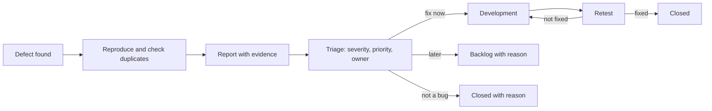

# Bug triage

✅ **Applied in practice** for the QA side (reproduce, classify, report, retest).
📚 **Study reference** for the triage meeting format below.
[Português](../pt-br/triagem-de-bug.md)

## Before triage (QA)
1. Reproduce at least twice; note the frequency.
2. Search for duplicates.
3. Check the expected result against the source (story, rule, prototype). If the rule is unclear, it is a **question**, not a bug.
4. Report it ([template](../../templates/en/bug-report.md)) with a proposed severity.

## In triage (QA, PO, tech lead)
| Decision | Who usually decides | Based on |
|---|---|---|
| Severity | QA proposes | Impact on the user and the product |
| Priority | PO | Business urgency, release date, workaround |
| Owner | Tech lead | Area of the code, capacity |
| Outcome | Together | Fix now, backlog with reason, or close with reason |

**Rule of thumb:** every closed-without-fix bug carries a written reason ("works as designed per BK-104", "duplicate of BUG-88"). Silent closes come back as arguments later.

## After the fix (QA)
- Retest on the same environment and platform where it failed.
- Run the cases closest to the change.
- If it fails again, reopen with the new evidence, not a new bug.
