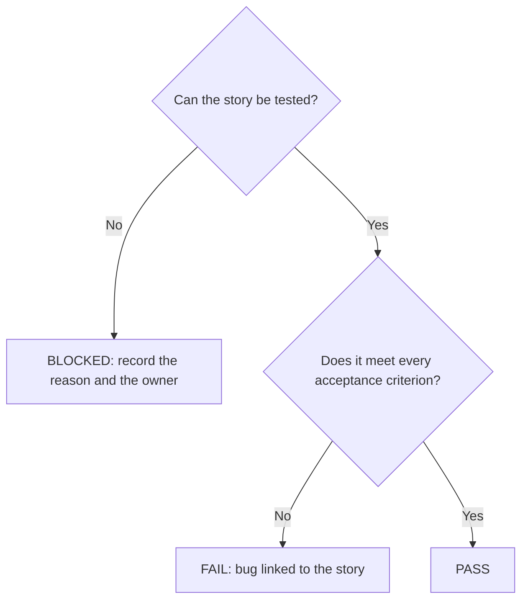

# Fail vs Blocked

✅ **Applied in practice** · Decision criteria I use when a story cannot be accepted. Examples are fictional (TrilhaFit).
[Português](../pt-br/fail-vs-blocked.md)

**The question that decides it:** *was I able to test?*

## Fail: tested, and it is wrong
| Situation | TrilhaFit example |
|---|---|
| Acceptance criterion not met | Booking 5 spots is accepted; the limit is 4 |
| Business rule broken | Premium member gets no credit back on late cancellation |
| Screen differs from prototype in a way that matters | *Join waitlist* button missing when class is full |
| API returns the wrong thing | Cancel returns 200 but the booking stays *Confirmed* |
| Regression | Check-in stopped working after the waitlist change |

**Next:** bug report with evidence, linked to the story; story goes back to development; retest after the fix.

## Blocked: could not test
| Situation | TrilhaFit example |
|---|---|
| Environment down or wrong build | Staging still on build 2.2 |
| Missing test data or account | No Premium test account available |
| Dependency not delivered | Notification service story not merged yet |
| Criterion too vague to decide | "Waitlist should be fair": fair how? |

**Next:** comment with the reason and who can unblock it; nobody is "at fault" in a Blocked; resume as soon as it clears.

## Found something outside the story?
If, while testing story A, I find a defect that story A did not cause, **story A does not fail for it**. I open a separate bug, link it to A as context, and A follows its own criteria. This keeps unrelated work moving without losing the defect.

## Why it matters
Mixing the two hides information. A Fail says *the code needs work*; a Blocked says *the process or environment needs work*. Counting them separately shows where the team is really losing time.
