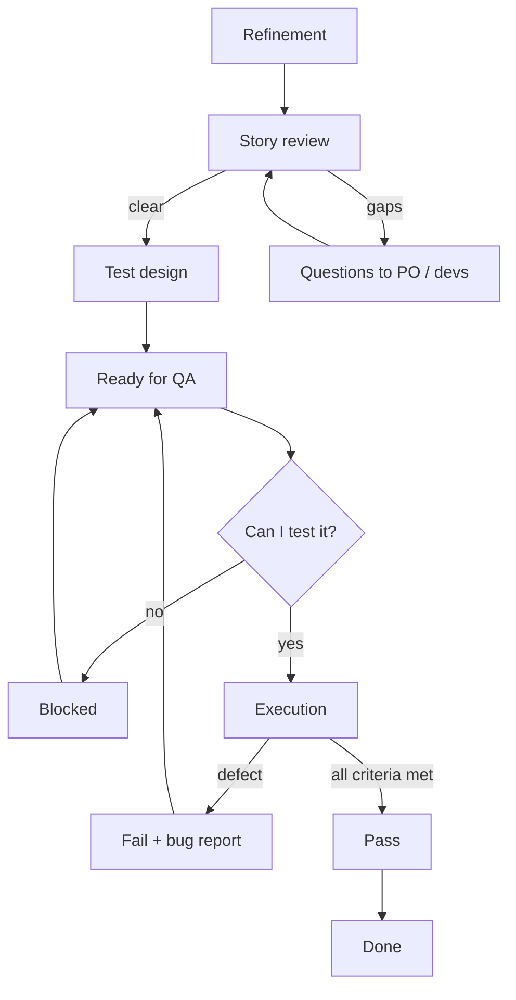

# QA flow for a user story

✅ **Applied in practice** · The flow I follow for each story in Agile squads (Jira and Azure DevOps boards). Example names are fictional.
[Português](../pt-br/fluxo-de-qa-da-historia.md)

## 1. Refinement and story review
Before any code exists, I read the story looking for what will be hard to test:
- Is every acceptance criterion **testable** (observable result, clear data)?
- Are business rules written down, or only implied?
- Does the prototype match the text?
- Which profiles, platforms and states are affected?

Gaps become a [story clarification report](../../templates/en/story-clarification-report.md). A question answered in refinement costs minutes; the same question found as a bug costs a sprint day.

## 2. Test design
- Pick the techniques that fit each rule ([guide](../../techniques/en/test-design-techniques.md)).
- Write the cases with traceability to the story ([template](../../templates/en/test-case.md)).
- Prepare test accounts per profile and the test data ([privacy checklist](../../templates/en/test-data-privacy-checklist.md)).

## 3. Execution
Order: **smoke** (does it open and respond?) → **happy path** → **business rules and negative cases** → **other platforms** → **exploratory pass** around the change.
Evidence (screen recording or screenshots) is attached to the result, not kept on my machine.

## 4. Outcome
| Result | What I do |
|---|---|
| **Pass** | Record results and evidence; story moves on |
| **Fail** | Open a bug linked to the story, return it to the developer ([Fail vs Blocked](fail-vs-blocked.md)) |
| **Blocked** | Record the blocker and who owns it; resume when cleared |

## 5. Retest
After a fix: retest the bug, then rerun the cases closest to the change. A fix that breaks the neighbor is still a failed story.
