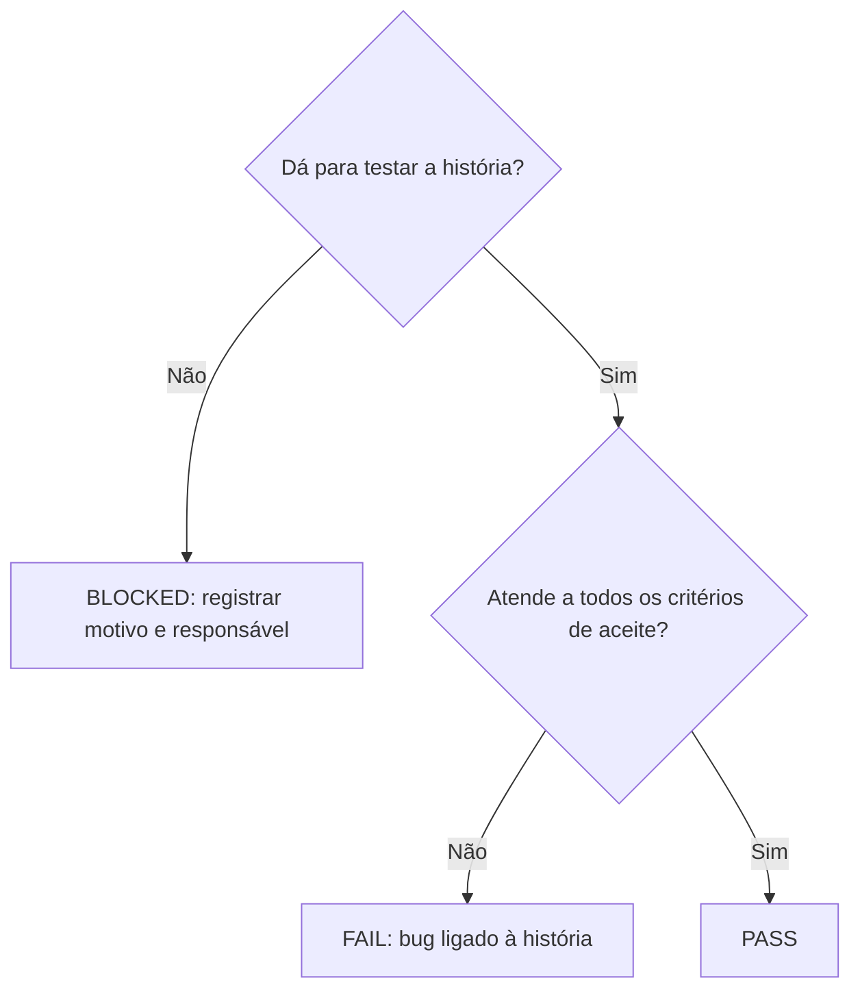

# Fail × Blocked

✅ **Aplicado na prática** · Critérios que uso quando uma história não pode ser aceita. Exemplos fictícios (TrilhaFit).
[English](../en/fail-vs-blocked.md)

**A pergunta que decide:** *eu consegui testar?*

## Fail: testei, e está errado
| Situação | Exemplo no TrilhaFit |
|---|---|
| Critério de aceite não atendido | Reservar 5 vagas é aceito; o limite é 4 |
| Regra de negócio quebrada | Aluno Premium não recebe crédito no cancelamento tardio |
| Tela diverge do protótipo de um jeito que importa | Falta o botão *Entrar na lista de espera* com a aula lotada |
| API devolve o resultado errado | Cancelamento retorna 200, mas a reserva continua *Confirmada* |
| Regressão | Check-in parou de funcionar depois da mudança na lista de espera |

**Depois:** bug report com evidência, ligado à história; história volta para o desenvolvimento; reteste depois da correção.

## Blocked: não consegui testar
| Situação | Exemplo no TrilhaFit |
|---|---|
| Ambiente fora do ar ou build errado | Staging ainda no build 2.2 |
| Falta massa ou conta de teste | Nenhuma conta Premium de teste disponível |
| Dependência não entregue | História do serviço de notificação ainda não integrada |
| Critério vago demais para decidir | "A lista de espera deve ser justa": justa como? |

**Depois:** comentário com o motivo e quem pode desbloquear; num Blocked ninguém "errou"; retomo assim que liberar.

## Achei algo fora da história?
Se, testando a história A, encontro um defeito que a história A não causou, **a A não reprova por isso**. Abro um bug separado, ligo à A como contexto, e a A segue pelos próprios critérios. O trabalho que não tem relação continua andando e o defeito não se perde.

## Por que importa
Misturar os dois esconde informação. Fail diz *o código precisa de ajuste*; Blocked diz *o processo ou o ambiente precisa de ajuste*. Contar separado mostra onde o time está perdendo tempo de verdade.
