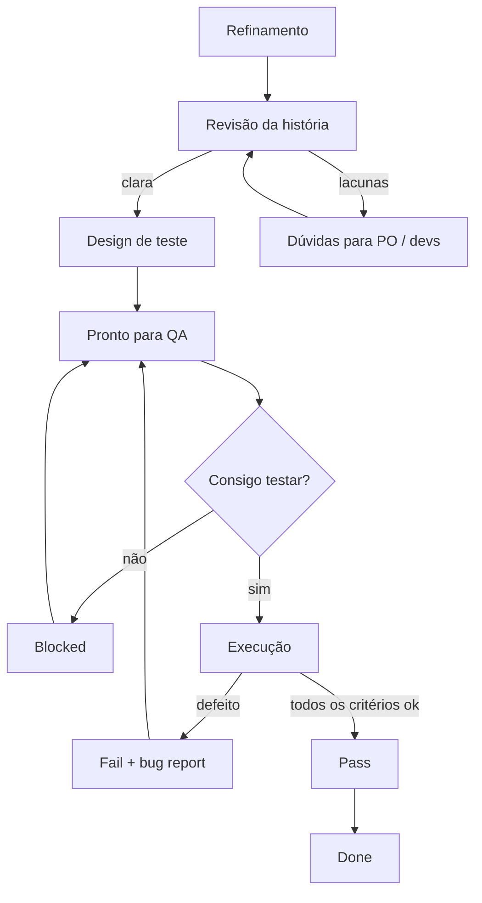

# Fluxo de QA de uma história (PBI)

✅ **Aplicado na prática** · O fluxo que sigo em cada história em squads ágeis (boards do Jira e do Azure DevOps). Os nomes dos exemplos são fictícios.
[English](../en/qa-flow-user-story.md)

## 1. Refinamento e revisão da história
Antes de existir código, leio a história procurando o que vai ser difícil de testar:
- Todo critério de aceite é **testável** (resultado observável, dados claros)?
- As regras de negócio estão escritas ou só subentendidas?
- O protótipo bate com o texto?
- Quais perfis, plataformas e estados são afetados?

As lacunas viram um [relatório de dúvidas](../../templates/pt-br/relatorio-de-duvidas.md). Uma dúvida respondida no refinamento custa minutos; a mesma dúvida achada como bug custa um dia de sprint.

## 2. Design de teste
- Escolher as técnicas que servem para cada regra ([guia](../../techniques/pt-br/tecnicas-de-design-de-teste.md)).
- Escrever os casos com rastreabilidade para a história ([template](../../templates/pt-br/caso-de-teste.md)).
- Preparar contas de teste por perfil e a massa de teste ([checklist de privacidade](../../templates/pt-br/massa-de-teste-e-privacidade.md)).

## 3. Execução
Ordem: **smoke** (abre e responde?) → **caminho feliz** → **regras de negócio e casos negativos** → **outras plataformas** → **passada exploratória** em volta da mudança.
A evidência (gravação de tela ou prints) vai anexada ao resultado, não fica na minha máquina.

## 4. Resultado
| Resultado | O que faço |
|---|---|
| **Pass** | Registro resultados e evidências; a história segue |
| **Fail** | Abro bug ligado à história e devolvo ao dev ([Fail × Blocked](fail-vs-blocked.md)) |
| **Blocked** | Registro o impedimento e quem resolve; retomo quando liberar |

## 5. Reteste
Depois da correção: reteste do bug e, em seguida, os casos mais próximos da mudança. Correção que quebra o vizinho continua sendo história reprovada.
