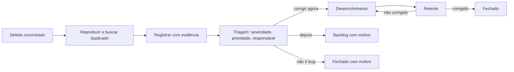

# Triagem de bug

✅ **Aplicado na prática** na parte do QA (reproduzir, classificar, registrar, retestar).
📚 **Referência de estudo** no formato da reunião de triagem abaixo.
[English](../en/bug-triage.md)

## Antes da triagem (QA)
1. Reproduzir pelo menos duas vezes; anotar a frequência.
2. Procurar duplicados.
3. Conferir o resultado esperado na fonte (história, regra, protótipo). Se a regra não está clara, é **dúvida**, não bug.
4. Registrar ([template](../../templates/pt-br/bug-report.md)) com uma severidade proposta.

## Na triagem (QA, PO, tech lead)
| Decisão | Quem costuma decidir | Com base em |
|---|---|---|
| Severidade | QA propõe | Impacto no usuário e no produto |
| Prioridade | PO | Urgência de negócio, data do release, contorno |
| Responsável | Tech lead | Área do código, capacidade |
| Destino | Juntos | Corrigir agora, backlog com motivo ou fechar com motivo |

**Regra prática:** todo bug fechado sem correção leva um motivo escrito ("comportamento previsto na BK-104", "duplicado do BUG-88"). Fechamento silencioso volta depois como discussão.

## Depois da correção (QA)
- Retestar no mesmo ambiente e plataforma em que falhou.
- Rodar os casos mais próximos da mudança.
- Se falhar de novo, reabrir com a evidência nova, não abrir outro bug.
