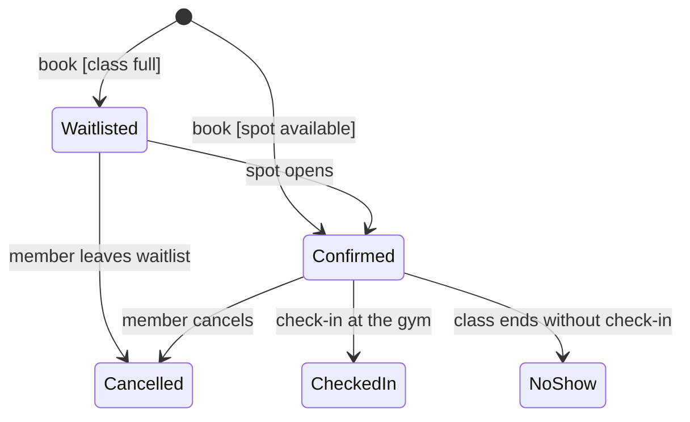

# Test design techniques

Organized along chapter 4 of the **ISTQB CTFL v4.0** syllabus (black-box and experience-based techniques). Every example is solved on **TrilhaFit**, a fictional gym class booking app.
[Português](../pt-br/tecnicas-de-design-de-teste.md)

| Technique | Syllabus | Label |
|---|---|---|
| [Equivalence partitioning](#1-equivalence-partitioning) | 4.2.1 | ✅ Applied in practice |
| [Boundary value analysis](#2-boundary-value-analysis) | 4.2.2 | ✅ Applied in practice |
| [Decision table testing](#3-decision-table-testing) | 4.2.3 | ✅ Applied in practice |
| [State transition testing](#4-state-transition-testing) | 4.2.4 | 📚 Study reference |
| [Error guessing](#5-error-guessing) | 4.4.1 | 📚 Study reference |
| [Exploratory testing](#6-exploratory-testing) | 4.4.2 | ✅ Applied in practice |

**The shared rule (TrilhaFit):** a member can book **1 to 4 spots** in one booking (for themselves and guests). Plans: *Basic*, *Plus*, *Premium*.

---

## 1. Equivalence partitioning
✅ **Applied in practice**

Split the inputs into **partitions** whose values the system should treat the same way. One value per partition is enough, because if one fails, the others in the same partition are expected to fail too.

**Example: number of spots in a booking**

| Partition | Values | Representative | Expected |
|---|---|---|---|
| Invalid: below | ≤ 0 | 0 | Rejected: "Choose at least 1 spot" |
| Valid | 1 to 4 | 2 | Booking created |
| Invalid: above | ≥ 5 | 7 | Rejected: "Maximum of 4 spots per booking" |

Partitions are not only numbers. *Plan type* has three valid partitions (Basic, Plus, Premium), one per plan, because each has different rules.

**Coverage:** partitions exercised ÷ total partitions. Above, 3 tests give 100%.
**Watch out:** test invalid partitions **one at a time**. Two invalid values in the same test hide each other.

---

## 2. Boundary value analysis
✅ **Applied in practice**

Defects cluster at the **edges** of ordered partitions (`<` instead of `<=`, off-by-one). The syllabus describes two versions:

- **2-value BVA:** each boundary value plus its closest neighbor in the **adjacent** partition.
- **3-value BVA:** each boundary value plus **both** neighbors. Stronger; catches more mistakes in the condition.

**Example: 1 to 4 spots** (boundaries are 1 and 4)

| Version | Values to test |
|---|---|
| 2-value | 0, 1, 4, 5 |
| 3-value | 0, 1, 2, 3, 4, 5 |

**Coverage:** boundary values exercised ÷ total identified boundary values.
**In practice:** I combine it with partitions. Partitions decide *which groups*; boundaries decide *which values inside them*.

---

## 3. Decision table testing
✅ **Applied in practice**

When an outcome depends on a **combination of conditions**, a table makes every combination visible, including the ones nobody wrote a rule for.

**Example: credit back when a member cancels**

| Conditions / Actions | R1 | R2 | R3 | R4 |
|---|---|---|---|---|
| Cancelled 12 h or more before class? | Yes | Yes | No | No |
| Premium plan? | Yes | No | Yes | No |
| **Full credit back** | ✓ | ✓ | | |
| **Half credit back** | | | ✓ | |
| **No credit back** | | | | ✓ |

Each column (rule) becomes at least one test. 2 conditions → 4 columns.

**Coverage:** columns exercised ÷ total feasible columns.
**Where it pays off most:** building the table *before* testing. An empty cell is a question for the PO, and finding it during refinement is cheaper than finding it as a bug.

---

## 4. State transition testing
📚 **Study reference**

Models the system as **states**, **events** that move it between states, and **guard conditions**. Good for anything with a lifecycle.

**Example: booking status**

| From | Event | To |
|---|---|---|
| Waitlisted | spot opens | Confirmed |
| Waitlisted | member leaves waitlist | Cancelled |
| Confirmed | member cancels | Cancelled |
| Confirmed | check-in at the gym | CheckedIn |
| Confirmed | class ends without check-in | NoShow |

**Coverage criteria in the syllabus:**
- **All states:** every state visited at least once.
- **Valid transitions (0-switch):** every valid transition exercised at least once.
- **All transitions:** every valid transition plus attempts at **invalid** ones (for example, trying to cancel a booking that is already *CheckedIn*).

---

## 5. Error guessing
📚 **Study reference**

Uses knowledge of how systems usually fail to anticipate defects. The syllabus suggests turning that knowledge into a list of **fault attacks**.

**Fault attacks for booking (TrilhaFit)**
- Tap *Book* twice quickly: does it create two bookings?
- Two members book the last spot at the same second
- Lose connection between tapping *Book* and the response
- Session expires while the booking screen is open
- Class at 00:00, or in a different time zone from the device
- Member changes plan (Premium → Basic) with bookings already made
- Very long names or emoji in the guest name field

---

## 6. Exploratory testing
✅ **Applied in practice**

Design, execution and evaluation happen **at the same time**, guided by what I learn while testing. It works best when specifications are thin or time is short, and it finds what scripted cases miss.

The syllabus describes **session-based** exploratory testing: a time-boxed session guided by a **charter**, followed by a debrief.

**Example charter**

| Field | Value |
|---|---|
| Charter | Explore **waitlist promotion** with **concurrent cancellations** to discover **wrong ordering or duplicate promotions** |
| Timebox | 60 minutes |
| Setup | Full class, 3 members on the waitlist, 2 devices and the web open |
| Notes | What I tried, what I saw, questions raised |
| Results | Bugs, questions for the PO, ideas for new scripted cases |

**After the session:** anything worth repeating becomes a scripted test case; anything unclear becomes a question on the story.
