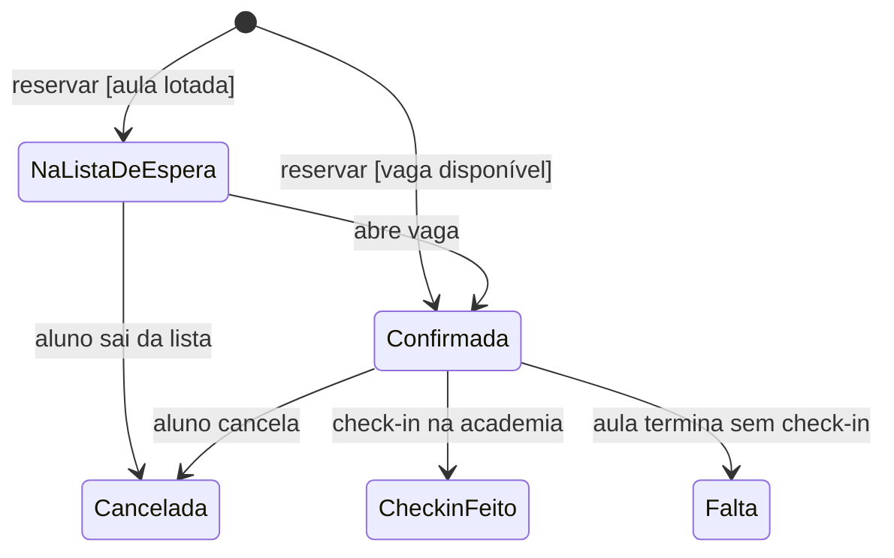

# Técnicas de design de teste

Organizadas pelo capítulo 4 do syllabus **ISTQB CTFL v4.0** (técnicas caixa-preta e baseadas em experiência). Todo exemplo é resolvido no **TrilhaFit**, um app fictício de reserva de aulas de academia.
[English](../en/test-design-techniques.md)

| Técnica | Syllabus | Selo |
|---|---|---|
| [Partição de equivalência](#1-partição-de-equivalência) | 4.2.1 | ✅ Aplicado na prática |
| [Análise de valor limite](#2-análise-de-valor-limite) | 4.2.2 | ✅ Aplicado na prática |
| [Tabela de decisão](#3-tabela-de-decisão) | 4.2.3 | ✅ Aplicado na prática |
| [Transição de estado](#4-transição-de-estado) | 4.2.4 | 📚 Referência de estudo |
| [Suposição de erro](#5-suposição-de-erro-error-guessing) | 4.4.1 | 📚 Referência de estudo |
| [Teste exploratório](#6-teste-exploratório) | 4.4.2 | ✅ Aplicado na prática |

**A regra comum (TrilhaFit):** o aluno pode reservar **de 1 a 4 vagas** numa reserva (para si e convidados). Planos: *Basic*, *Plus*, *Premium*.

---

## 1. Partição de equivalência
✅ **Aplicado na prática**

Divide as entradas em **partições** cujos valores o sistema deve tratar do mesmo jeito. Um valor por partição basta: se um falha, espera-se que os outros da mesma partição falhem também.

**Exemplo: número de vagas numa reserva**

| Partição | Valores | Representante | Esperado |
|---|---|---|---|
| Inválida: abaixo | ≤ 0 | 0 | Rejeitado: "Escolha pelo menos 1 vaga" |
| Válida | 1 a 4 | 2 | Reserva criada |
| Inválida: acima | ≥ 5 | 7 | Rejeitado: "Máximo de 4 vagas por reserva" |

Partição não é só número. *Tipo de plano* tem três partições válidas (Basic, Plus, Premium), uma por plano, porque cada uma tem regras diferentes.

**Cobertura:** partições exercitadas ÷ total de partições. Acima, 3 testes dão 100%.
**Cuidado:** teste partições inválidas **uma de cada vez**. Dois valores inválidos no mesmo teste escondem um ao outro.

---

## 2. Análise de valor limite
✅ **Aplicado na prática**

Os defeitos se concentram nas **bordas** de partições ordenadas (`<` no lugar de `<=`, erro de um a mais). O syllabus descreve duas versões:

- **BVA de 2 valores:** cada valor limite mais o vizinho mais próximo na partição **adjacente**.
- **BVA de 3 valores:** cada valor limite mais **os dois** vizinhos. Mais forte; pega mais erros na condição.

**Exemplo: de 1 a 4 vagas** (os limites são 1 e 4)

| Versão | Valores a testar |
|---|---|
| 2 valores | 0, 1, 4, 5 |
| 3 valores | 0, 1, 2, 3, 4, 5 |

**Cobertura:** valores limite exercitados ÷ total de valores limite identificados.
**Na prática:** combino com partição. A partição decide *quais grupos*; o valor limite decide *quais valores dentro deles*.

---

## 3. Tabela de decisão
✅ **Aplicado na prática**

Quando o resultado depende de uma **combinação de condições**, a tabela deixa toda combinação visível, inclusive as que ninguém escreveu regra.

**Exemplo: crédito devolvido quando o aluno cancela**

| Condições / Ações | R1 | R2 | R3 | R4 |
|---|---|---|---|---|
| Cancelou 12 h ou mais antes da aula? | Sim | Sim | Não | Não |
| Plano Premium? | Sim | Não | Sim | Não |
| **Crédito integral** | ✓ | ✓ | | |
| **Metade do crédito** | | | ✓ | |
| **Sem crédito** | | | | ✓ |

Cada coluna (regra) vira pelo menos um teste. 2 condições → 4 colunas.

**Cobertura:** colunas exercitadas ÷ total de colunas viáveis.
**Onde rende mais:** montar a tabela *antes* de testar. Célula vazia é pergunta para o PO, e achá-la no refinamento sai mais barato que achá-la como bug.

---

## 4. Transição de estado
📚 **Referência de estudo**

Modela o sistema como **estados**, **eventos** que levam de um estado a outro e **condições de guarda**. Boa para tudo que tem ciclo de vida.

**Exemplo: status da reserva**

| De | Evento | Para |
|---|---|---|
| Na lista de espera | abre vaga | Confirmada |
| Na lista de espera | aluno sai da lista | Cancelada |
| Confirmada | aluno cancela | Cancelada |
| Confirmada | check-in na academia | Check-in feito |
| Confirmada | aula termina sem check-in | Falta |

**Critérios de cobertura do syllabus:**
- **Todos os estados:** cada estado visitado pelo menos uma vez.
- **Transições válidas (0-switch):** cada transição válida exercitada pelo menos uma vez.
- **Todas as transições:** todas as válidas mais tentativas de transições **inválidas** (por exemplo, tentar cancelar uma reserva que já está com *Check-in feito*).

---

## 5. Suposição de erro (*error guessing*)
📚 **Referência de estudo**

Usa o conhecimento de como os sistemas costumam falhar para antecipar defeitos. O syllabus sugere transformar esse conhecimento numa lista de **ataques de falha** (*fault attacks*).

**Ataques de falha para a reserva (TrilhaFit)**
- Tocar em *Reservar* duas vezes rápido: cria duas reservas?
- Dois alunos reservam a última vaga no mesmo segundo
- Perder a conexão entre o toque em *Reservar* e a resposta
- Sessão expira com a tela de reserva aberta
- Aula às 00:00, ou em fuso diferente do aparelho
- Aluno troca de plano (Premium → Basic) com reservas já feitas
- Nomes muito longos ou emoji no campo de convidado

---

## 6. Teste exploratório
✅ **Aplicado na prática**

Design, execução e avaliação acontecem **ao mesmo tempo**, guiados pelo que aprendo enquanto testo. Funciona melhor quando a especificação é rasa ou o tempo é curto, e encontra o que os casos roteirizados deixam passar.

O syllabus descreve o teste exploratório **baseado em sessão**: uma sessão com tempo definido, guiada por um **charter**, seguida de um debriefing.

**Exemplo de charter**

| Campo | Valor |
|---|---|
| Charter | Explorar a **promoção da lista de espera** com **cancelamentos simultâneos** para descobrir **ordem errada ou promoção duplicada** |
| Tempo | 60 minutos |
| Preparação | Aula lotada, 3 alunos na lista de espera, 2 aparelhos e a web abertos |
| Anotações | O que tentei, o que vi, dúvidas que surgiram |
| Resultados | Bugs, dúvidas para o PO, ideias de novos casos roteirizados |

**Depois da sessão:** o que vale repetir vira caso de teste roteirizado; o que ficou confuso vira dúvida na história.
